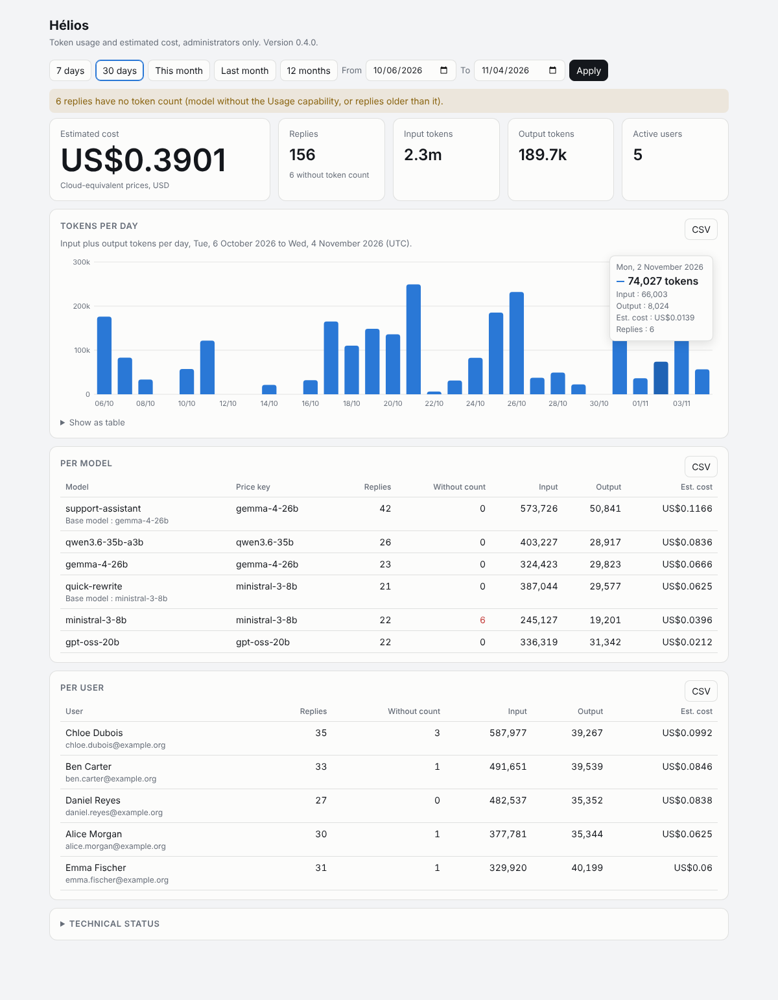
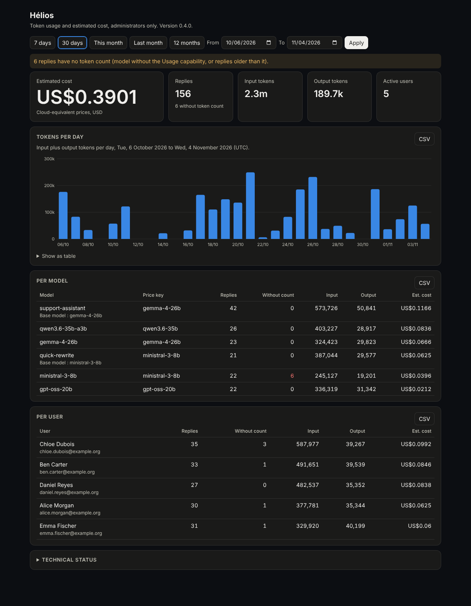
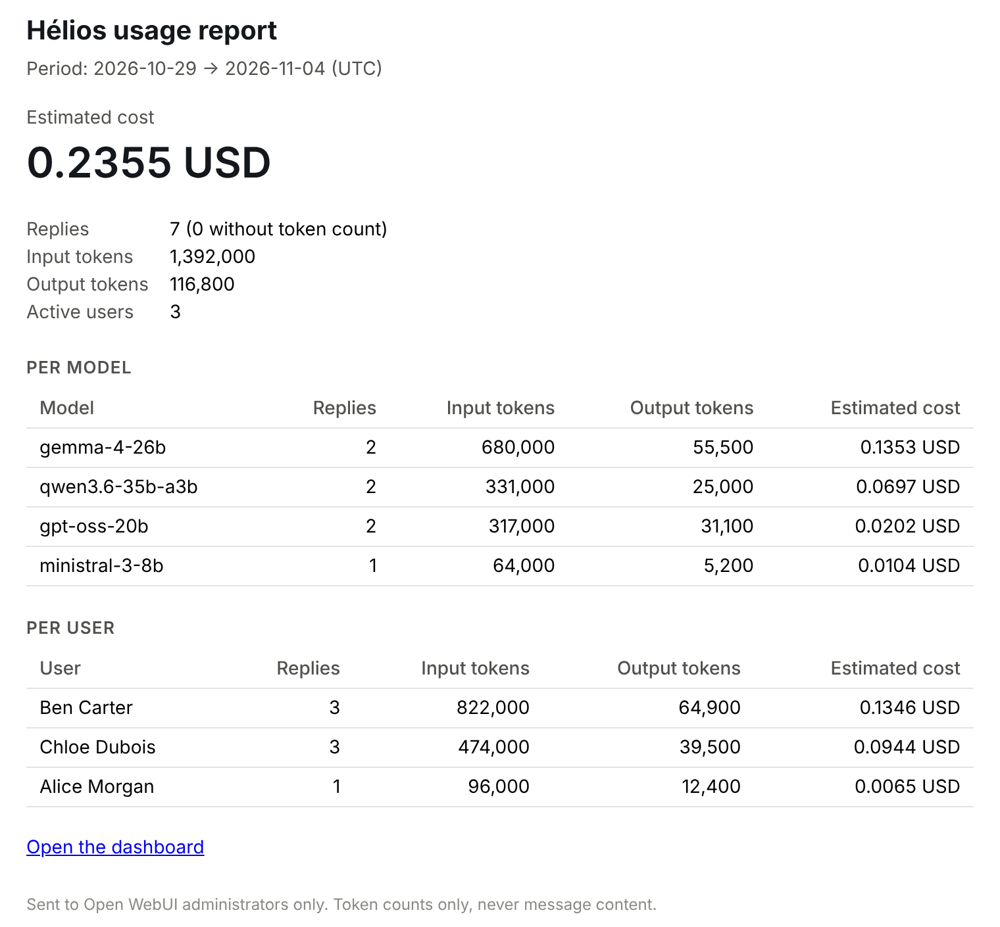

# Hélios

**Token usage and estimated cost dashboard for Open WebUI. Admin only, one file, no message content.**

Hélios is an [Open WebUI](https://github.com/open-webui/open-webui) Function that keeps its own history of token usage per model and per user, shows it on an admin-only page (`/usage`), and can email a periodic report to your administrators.

Open WebUI deletes old chats if you run a retention job such as Prune, and the token counts go with them. Hélios copies only the numbers into a separate table, so your usage history outlives your chat retention policy.



<details>
<summary>Dark theme and email report</summary>





</details>

All data in these screenshots is fictitious.

## What it does

- **Usage history that survives chat pruning.** Token counts are copied into their own table (`helios.usage`) every few hours. Kept 13 months by default.
- **Cost per model and per user**, from a price table you define. Estimates only, not a bill.
- **Dashboard** with period filters (7 days, 30 days, this month, last month, 12 months, custom), daily chart, per-model and per-user tables, CSV export. No external script, font or CDN: the page works on an offline network.
- **Email report** to your administrators on a daily, weekly or monthly schedule, through an SMTP relay you configure. Unauthenticated relays are supported.
- **Visibility into gaps.** Replies for which the model reported no token count are counted and flagged, not silently ignored. Models without a price are flagged and excluded from the cost.
- **Optional pseudonymization** of user names (on by default).
- **Bilingual page and report**: English and French, selectable or automatic.

## What it does not do

- It never reads message content. It reads only `chat_message.id`, `user_id`, `model_id`, `done`, `role`, `usage`, `created_at`, `updated_at` and `model.base_model_id`. It does not store chat identifiers.
- It does not enforce quotas or block anyone. It reports.
- It does not show users their own usage. The page and the report are for administrators.

## Requirements

| | |
|---|---|
| Open WebUI | 0.13.0 (the version it was written and tested against) |
| Database | PostgreSQL (Hélios creates its own schema). SQLite is not supported |
| Python packages | None beyond what Open WebUI already ships |
| Redis | Optional. Used to make sure only one worker sends a given report |

Other Open WebUI versions are untested. Hélios reads Open WebUI's `chat_message` table, so a schema change in a future release could break collection.

## Installation

1. In Open WebUI, go to **Admin Panel > Functions** and create a new function.
2. Paste the contents of [`helios.py`](helios.py) and save.
3. Enable the function. Hélios initializes immediately, creates the `helios` schema and backfills what already exists. No restart needed.
4. Open the function's settings (valves) and set at least `timezone`, `currency` and `price_map`.
5. Browse to `https://your-open-webui/usage` as an administrator.

**Important:** token counts only exist for models that report them. In **Admin Panel > Models**, open each model and enable the **Usage** capability. Without it, Open WebUI stores `{"incomplete": true}` and Hélios can only count the reply as "without token count".

## Configuration (valves)

| Valve | Default | Meaning |
|---|---|---|
| `route_prefix` | `/usage` | Path of the admin page. Applied on restart or code update |
| `ui_language` | `auto` | `auto` (browser language), `en` or `fr` |
| `timezone` | `UTC` | Time zone for days and report time, for example `Europe/Paris` |
| `collect_interval_minutes` | `180` | Minutes between collection passes (minimum 15) |
| `collect_min_age_minutes` | `10` | Only collect replies finished at least this long ago |
| `collect_window_days` | `3` | Window re-read on each pass, to catch late-finishing replies |
| `retention_months` | `13` | How long usage rows are kept (`0` keeps them forever) |
| `currency` | `USD` | Currency label for the estimated cost |
| `price_map` | `{}` | Price per million tokens, JSON (see below) |
| `pseudonymize_users` | `true` | Replace user names with a stable pseudonym on the page and in the report |
| `pseudonym_salt` | empty | Salt for pseudonyms. Empty: Hélios generates and keeps one |
| `mail_enabled` | `false` | Send the periodic report |
| `mail_frequency` | `weekly` | `daily`, `weekly` (Monday) or `monthly` (1st of the month) |
| `mail_hour` | `7` | Send hour in the configured time zone |
| `mail_include_user_detail` | `true` | Per-user table in the report (follows pseudonymization) |
| `mail_language` | `en` | Report language, `en` or `fr` |
| `dashboard_url` | empty | Optional link to the dashboard inside the report |
| `mail_recipients` | empty | Comma-separated addresses (see Security) |
| `mail_from` | empty | Sender address |
| `smtp_host`, `smtp_port` | empty, `587` | SMTP relay |
| `smtp_security` | `starttls` | `starttls`, `ssl` or `none` |
| `smtp_verify_cert` | `true` | Verify the relay certificate |
| `smtp_username` | empty | Empty means no authentication |
| `smtp_password` | empty | Ignored if the `HELIOS_SMTP_PASSWORD` environment variable is set (recommended) |

### Price map

Prices are per million tokens. Keys are model ID prefixes. The longest matching prefix wins, first against the model ID, then against the model's base model (so a custom preset built on `gemma-4-26b` is priced as `gemma-4-26b`).

```json
{
  "gpt-oss-20b":   {"input": 0.05, "output": 0.14},
  "gemma-4-26b":   {"input": 0.15, "output": 0.60},
  "qwen3.6-35b":   {"input": 0.15, "output": 0.80}
}
```

Models with no match are shown as having no price, and their tokens are left out of the cost. For self-hosted models there is no real price: many people use the price of an equivalent hosted model to get a cloud-equivalent figure. The dashboard labels the cost accordingly.

## How tokens are counted

Hélios applies the same rule as Open WebUI's own token columns: input is `input_tokens`, else `prompt_tokens`; output is `output_tokens`, else `completion_tokens`. Values that are not integers are ignored.

Known uncertainty: on replies that involve several tool-call rounds, `input_tokens` has been seen to be much larger than `prompt_tokens`. Whether Open WebUI adds up all rounds into `input_tokens` has not been verified, so costs for tool-heavy models may be an upper estimate.

## Email report

The report covers the previous full period (day, week or month) and is sent once per period, even after a restart. The **Technical status** section of the page has a button that sends a test report covering the last 7 days.

Recipients are checked on every send: **an address in `mail_recipients` only receives the report if it belongs to an Open WebUI account with the `admin` role.** Other addresses are skipped and listed on the page. If none remains, nothing is sent. This keeps a typo or a former admin from receiving per-user figures.

Users never receive anything from Hélios.

## Security and privacy

- The page is served only to a signed-in administrator. Anyone else is redirected to the home page.
- Every API route requires an administrator. If the function is disabled or deleted, the routes answer 404.
- The two POST routes (manual collection, test mail) also require an `Authorization: Bearer` header, so a cookie alone cannot trigger them from another site.
- Pages are rendered without injecting HTML, and responses are sent with `Cache-Control: no-store`, `X-Content-Type-Options: nosniff` and `Referrer-Policy: no-referrer`.
- CSV cells starting with `=`, `+`, `-` or `@` are neutralized.
- Stored per reply: message ID, timestamp, user ID, model ID, base model ID, input and output token counts. No content, no chat ID.

Hélios is a function: it runs inside the Open WebUI process with the same access as Open WebUI. Read the code before you install it. It is a single file.

If you are in a jurisdiction with data protection law, a per-user usage log is personal data. Decide who can see it, tell your users, and keep the retention proportionate. `pseudonymize_users` and `retention_months` exist for that. This is not legal advice.

See [SECURITY.md](SECURITY.md) to report a vulnerability.

## Limitations

- Tested with a single Open WebUI worker. With several workers or replicas, collection is idempotent and mail uses a Redis claim when Redis is available, but this setup has not been tested.
- A reply is counted once it is finished and old enough (`collect_min_age_minutes`). The most recent minutes are not in the figures yet.
- Only assistant replies stored in `chat_message` are counted, from their `usage` field.
- Costs are estimates built from the prices you enter.

## Uninstall

Delete the function in Open WebUI, then remove its data:

```sql
DROP SCHEMA helios CASCADE;
```

Open WebUI's migrations do not touch the `helios` schema, so it stays until you drop it. A full database dump includes it; a dump limited to the `public` schema does not.

## License

[GNU AGPL v3.0 or later](LICENSE). Copyright (c) 2026 ANTOINE Pierre.

Hélios is an independent community project. It is not affiliated with or endorsed by Open WebUI.
