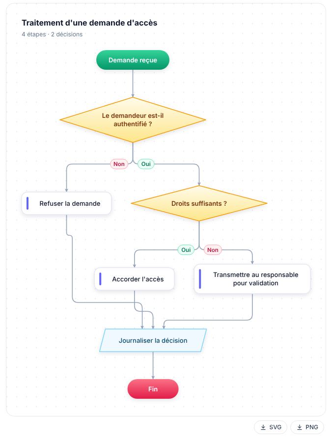
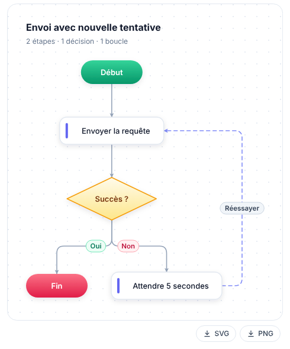

# Diagramme de flux automatique (Automatic Flowchart)

An **Open WebUI Action** that turns a chat answer into a clean flowchart in one click: start, steps, decisions with yes/no branches, loops and end, rendered as SVG directly in the chat.

[Version française plus bas](#français)

## Features

- **One button** under each answer, next to the other actions.
- **Standard shapes**: rounded pill for start and end, card for steps, diamond for decisions, parallelogram for input and output, dashed card for notes.
- **Readable branches**: Yes/No edge labels are colour coded (green, red), loops are drawn as dashed lines on a side lane.
- **Automatic layout** computed in pure Python (layered layout with cycle handling and crossing reduction). No Mermaid, no D3, no external library.
- **Readable without JavaScript**: the diagram is plain SVG. A small optional script only adds the PNG download.
- **Downloads**: SVG (plain link) and PNG (drawn locally in the browser), always on a white background.
- **Progress feedback**: start and finish notifications, plus a status line in the chat.
- **Private by design**: no file written on the server, no network call from the plugin, logs contain metadata only.

## Requirements

| Item | Value |
|---|---|
| Open WebUI | tested on **0.13.0** (declares 0.11.0 as minimum, see [docs](docs/GUIDE.md#compatibility)) |
| Python packages | none to install (no `requirements:` line) |
| Model | any chat model available in Open WebUI that can return JSON (local models work) |

## Installation

1. Open **Admin Panel > Functions** and create a new function.
2. Paste the content of [`diagramme_de_flux.py`](diagramme_de_flux.py) and save.
3. Enable the function, then mark it as **Global** so the button appears under every answer (or assign it to specific models).
4. Optional: check the file integrity against the SHA-256 published in the [changelog](CHANGELOG.md).

## Usage

Ask a question whose answer describes a process (a procedure, a decision path, a workflow), then click the **Diagramme de flux automatique** button under the answer. If the text does not describe any process, you get a "no process detected" notification and nothing is added to the chat.

## Configuration (valves)

| Valve | Default | Description |
|---|---|---|
| `priority` | `0` | Button order among the actions (lower = further left). |
| `MODEL_ID` | empty | Model used for the extraction. Empty = model of the conversation. |
| `DIRECTION` | `AUTO` | `AUTO` (model's choice), `TB` (top to bottom) or `LR` (left to right). |
| `MAX_NODES` | `30` | Maximum number of steps (bounded between 3 and 60). |
| `MESSAGE_COUNT` | `1` | Number of recent messages used (1 = the clicked answer only). |
| `MAX_INPUT_CHARS` | `8000` | Maximum text size sent to the model. |
| `MIN_TEXT_LENGTH` | `80` | Minimum text length, in characters. |
| `TIMEOUT_SECONDS` | `120` | Maximum duration of one model call. |
| `LANGUAGE` | `fr` | Language of labels and interface messages (`fr`, `en`). |
| `ENABLE_EXPORT` | `true` | SVG and PNG download buttons. |
| `SHOW_STATUS` | `true` | Show progress in the chat. |

Full details: [docs/GUIDE.md](docs/GUIDE.md).

## Documentation

- [User and admin guide](docs/GUIDE.md): how it works, configuration, troubleshooting, test checklist.
- [Security policy](SECURITY.md): security model, data handling, reporting a vulnerability.
- [Changelog](CHANGELOG.md)

## License

[MIT](LICENSE)

---

## Français

**Diagramme de flux automatique** est une Action Open WebUI : un bouton sous une réponse du chat la transforme en logigramme propre (début, étapes, décisions avec branches oui/non, boucles, fin), affiché en SVG directement dans le chat.

### Points clés

- Un seul bouton, rangé avec les autres actions.
- Formes standard : pastille pour le début et la fin, carte pour les étapes, losange pour les décisions, parallélogramme pour les entrées et sorties.
- Étiquettes Oui/Non colorées, boucles en pointillé sur un couloir latéral.
- Mise en page calculée en Python pur, sans Mermaid, D3 ni bibliothèque externe.
- Lisible sans JavaScript. Téléchargement SVG et PNG, toujours sur fond blanc.
- Aucun fichier écrit sur le serveur, aucun appel réseau, journaux limités aux métadonnées.

### Installation

1. **Panneau d'administration > Fonctions**, créer une nouvelle fonction.
2. Coller le contenu de [`diagramme_de_flux.py`](diagramme_de_flux.py), enregistrer.
3. Activer la fonction et la passer en **globale** (ou l'associer à certains modèles).
4. Facultatif : vérifier l'empreinte SHA-256 indiquée dans le [changelog](CHANGELOG.md).

### Utilisation

Posez une question dont la réponse décrit un processus, puis cliquez sur le bouton **Diagramme de flux automatique** sous la réponse. Si le texte ne décrit aucun processus, une notification « Aucun processus détecté » s'affiche et rien n'est ajouté au chat.

### Réglages

Les valves sont décrites dans le tableau ci-dessus (section anglaise). Les plus utiles : `MODEL_ID` pour imposer un modèle, `DIRECTION` pour forcer le sens, `MAX_NODES` pour limiter la taille, `LANGUAGE` pour la langue des libellés.

### Limites

- Chaque clic ajoute un diagramme au message (comportement d'Open WebUI) : l'écran affiche le plus récent, la base conserve les précédents jusqu'à suppression du chat.
- La qualité dépend du modèle : un petit modèle peut produire un JSON invalide. Le plugin fait une nouvelle tentative, puis affiche un message d'erreur propre.
- La largeur du texte est estimée, pas mesurée : des libellés très longs peuvent frôler le bord des formes.

Documentation complète (en anglais) : [docs/GUIDE.md](docs/GUIDE.md). Politique de sécurité : [SECURITY.md](SECURITY.md). Licence : [MIT](LICENSE).
