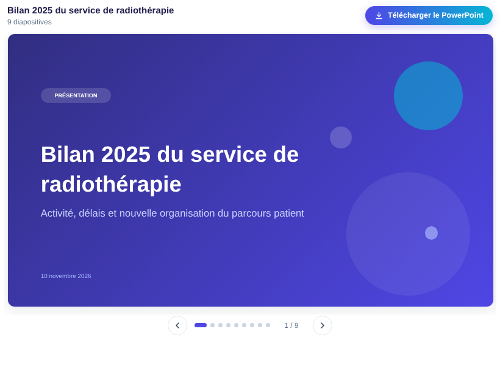

# Flash Powerpoint

An **Open WebUI Action** that turns a chat answer into a ready-to-present PowerPoint deck in one click, with a slider preview right in the chat and a `.pptx` download.

[Version française plus bas](#français)

## Features

- **One button, no question asked.** The model composes the deck itself from the clicked answer: 3 to 10 slides after the cover, adapted to the content.
- **Eight slide types**: cover, key points, two columns, key figures, chart, numbered steps, key message, takeaways.
- **No invented numbers.** Every figure shown on a key-figures card or a chart must appear in the source text; otherwise it is removed and the user is told.
- **Real PowerPoint content**: native shapes, a native column chart that stays editable, real bullets, speaker notes on every slide, 16:9 format.
- **Slider preview** in the chat: arrows, dots, counter, swipe or keyboard. Built from the same layout as the `.pptx`.
- **Progress feedback**: start and finish notifications, plus a status line.
- **Private by design**: the file is generated in memory, never written on the server; no network call from the plugin; logs contain metadata only.

## Requirements

| Item | Value |
|---|---|
| Open WebUI | tested on **0.13.0** (declares 0.11.0 as minimum, see [docs](docs/GUIDE.md#compatibility)) |
| Python packages | `python-pptx`, already shipped with Open WebUI (tested with 0.6.21 and 1.0.2); nothing to install |
| Model | any chat model available in Open WebUI that can return JSON (local models work) |
| Font | Segoe UI (present on Windows; PowerPoint for Mac substitutes a similar font) |

## Installation

1. Open **Admin Panel > Functions** and create a new function.
2. Paste the content of [`flash_powerpoint.py`](flash_powerpoint.py) and save.
3. Enable the function, then mark it as **Global** (or assign it to specific models).
4. Optional: check the file integrity against the SHA-256 published in the [changelog](CHANGELOG.md).

## Usage

Click **Flash Powerpoint** under an answer. After a few seconds, a slider shows the slides; the **Download PowerPoint** button saves the `.pptx`.

If the answer is too short or has no substance for a presentation, a notification explains it and nothing is added to the chat.

## Configuration (valves)

| Valve | Default | Description |
|---|---|---|
| `priority` | `0` | Button order among the actions (lower = further left). |
| `MODEL_ID` | empty | Model used to structure the deck. Empty = model of the conversation. |
| `MAX_SLIDES` | `10` | Maximum number of slides after the cover (bounded between 3 and 15). |
| `SPEAKER_NOTES` | `true` | Add speaker notes to the `.pptx`. |
| `MESSAGE_COUNT` | `1` | Number of recent messages used (1 = the clicked answer only). |
| `MAX_INPUT_CHARS` | `12000` | Maximum text size sent to the model. |
| `MIN_TEXT_LENGTH` | `150` | Minimum text length, in characters. |
| `TIMEOUT_SECONDS` | `180` | Maximum duration of one model call. |
| `LANGUAGE` | `fr` | Language of the slides and interface messages (`fr`, `en`). |
| `SHOW_STATUS` | `true` | Show progress in the chat. |

Full details: [docs/GUIDE.md](docs/GUIDE.md).

## Documentation

- [User and admin guide](docs/GUIDE.md): how it works, slide types, configuration, troubleshooting, test checklist.
- [Security policy](SECURITY.md): security model, data handling, reporting a vulnerability.
- [Changelog](CHANGELOG.md)

## License

[MIT](LICENSE)

---

## Français

**Flash Powerpoint** est une Action Open WebUI : un clic sous une réponse du chat produit une présentation PowerPoint prête à projeter, avec un aperçu en slider dans le chat et le téléchargement du `.pptx`.

### Points clés

- Un seul bouton, aucune question : le modèle compose lui-même 3 à 10 diapositives après la couverture, selon le contenu.
- Huit types de diapositives : couverture, points clés, deux colonnes, chiffres clés, graphique, étapes numérotées, message clé, « À retenir ».
- Aucun chiffre inventé : un chiffre affiché doit figurer dans le texte source, sinon il est retiré et l'utilisateur est prévenu.
- Vrai contenu PowerPoint : formes natives, graphique natif modifiable, vraies puces, notes de l'orateur, format 16:9.
- Aperçu en slider (flèches, points, compteur, clavier), construit à partir de la même mise en page que le fichier.
- Fichier généré en mémoire, jamais écrit sur le serveur, aucun appel réseau, journaux limités aux métadonnées.

### Installation

1. **Panneau d'administration > Fonctions**, créer une nouvelle fonction.
2. Coller le contenu de [`flash_powerpoint.py`](flash_powerpoint.py), enregistrer.
3. Activer la fonction et la passer en **globale** (ou l'associer à certains modèles).
4. Facultatif : vérifier l'empreinte SHA-256 indiquée dans le [changelog](CHANGELOG.md).

### Utilisation

Cliquez sur **Flash Powerpoint** sous une réponse. Après quelques secondes, le slider affiche les diapositives et le bouton **Télécharger le PowerPoint** enregistre le `.pptx`.

### Réglages

Les valves sont décrites dans le tableau de la section anglaise. Les plus utiles : `MODEL_ID` pour imposer un modèle, `MAX_SLIDES` pour la longueur, `SPEAKER_NOTES` pour les notes de l'orateur, `LANGUAGE` pour la langue.

### Limites

- La police Segoe UI est présente sur Windows ; sous macOS, PowerPoint la remplace par une police proche.
- La taille du texte est ajustée par estimation : un texte très dense peut frôler le bord d'une zone.
- Pas de photos ni d'icônes externes : le design repose sur la typographie, les couleurs et les formes.
- Chaque clic ajoute un aperçu au message (comportement d'Open WebUI), avec le `.pptx` intégré : environ 120 Ko par présentation de 9 diapositives en base, supprimés avec le chat.

Documentation complète (en anglais) : [docs/GUIDE.md](docs/GUIDE.md). Politique de sécurité : [SECURITY.md](SECURITY.md). Licence : [MIT](LICENSE).
