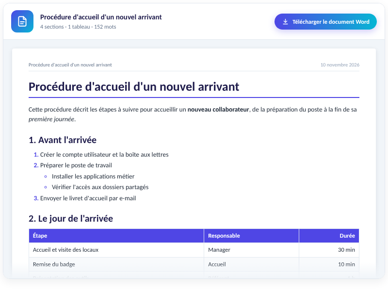
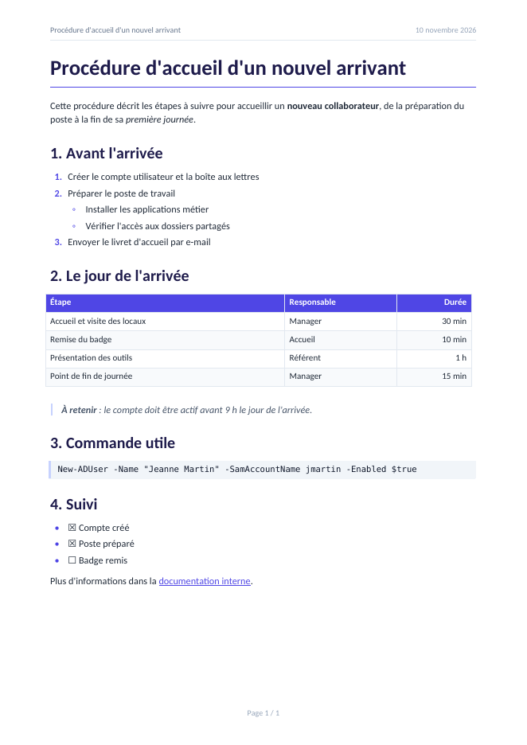

# Flash Word

An **Open WebUI Action** that turns a chat answer into a clean Word document (`.docx`) in one click: headings, lists, tables, code, quotes and links, with a preview in the chat.

[Version française plus bas](#français)

## Features

- **One button, instant result.** No model call: the Markdown of the answer is converted by code, so the document is faithful word for word and nothing is sent anywhere.
- **Real Word structure**: built-in heading styles (the navigation pane works), real numbered and bulleted lists on two levels, task lists, tables with a header row repeated on each page, code blocks, quotes, horizontal rules, clickable links.
- **Clean layout**: A4, Calibri 11 pt, indigo headings, sober tables with alternating rows, header with title and date, footer with "Page X / Y".
- **Preview in the chat**: a card with the title, a summary (sections, tables, words), the download button and a scrollable preview of the document.
- **Cleanup**: the model's reasoning (`<think>`, `
` blocks) is removed; only `http`, `https` and `mailto` links are kept clickable.
- **Private by design**: the file is generated in memory, never written on the server; logs contain metadata only.

## Requirements

| Item | Value |
|---|---|
| Open WebUI | tested on **0.13.0** (declares 0.11.0 as minimum, see [docs](docs/GUIDE.md#compatibility)) |
| Python packages | `python-docx`, already shipped with Open WebUI (tested with 0.8.11 and 1.2.0); nothing to install |
| Model | none |
| Font | Calibri (present wherever Microsoft Office is installed, Windows and macOS) |

## Installation

1. Open **Admin Panel > Functions** and create a new function.
2. Paste the content of [`flash_word.py`](flash_word.py) and save.
3. Enable the function, then mark it as **Global** (or assign it to specific models).
4. Optional: check the file integrity against the SHA-256 published in the [changelog](CHANGELOG.md).

## Usage

Click **Flash Word** under an answer. The card appears at once with a preview; **Download Word document** saves the `.docx`.

## Configuration (valves)

| Valve | Default | Description |
|---|---|---|
| `priority` | `0` | Button order among the actions (lower = further left). |
| `MESSAGE_COUNT` | `1` | Number of recent messages exported (1 = the clicked answer only). |
| `HEADER_FOOTER` | `true` | Header (title, date) and footer (Page X / Y). |
| `MIN_TEXT_LENGTH` | `20` | Minimum text length, in characters. |
| `LANGUAGE` | `fr` | Language of the interface messages and of the document (`fr`, `en`). |
| `SHOW_STATUS` | `true` | Show progress in the chat. |

Full details: [docs/GUIDE.md](docs/GUIDE.md).

## Documentation

- [User and admin guide](docs/GUIDE.md): supported Markdown, layout, configuration, troubleshooting, test checklist.
- [Security policy](SECURITY.md): security model, data handling, reporting a vulnerability.
- [Changelog](CHANGELOG.md)

## License

[MIT](LICENSE)

---

## Français

**Flash Word** est une Action Open WebUI : un clic sous une réponse du chat produit un document Word (`.docx`) propre, avec un aperçu dans le chat.

### Points clés

- Instantané et fidèle : aucun appel au modèle, le Markdown de la réponse est converti par du code. Rien n'est envoyé nulle part.
- Vraie structure Word : styles de titres (le volet de navigation fonctionne), vraies listes numérotées et à puces sur deux niveaux, cases à cocher, tableaux avec en-tête répété sur chaque page, blocs de code, citations, liens cliquables.
- Mise en page sobre : A4, Calibri 11 pt, titres indigo, tableaux à lignes alternées, en-tête avec titre et date, pied de page « Page X / Y ».
- Aperçu dans le chat : carte avec titre, résumé, bouton de téléchargement et aperçu du document avec défilement.
- Le raisonnement du modèle (`<think>`, blocs `
`) est retiré ; seuls les liens `http`, `https` et `mailto` restent cliquables.
- Fichier généré en mémoire, jamais écrit sur le serveur, journaux limités aux métadonnées.

### Installation

1. **Panneau d'administration > Fonctions**, créer une nouvelle fonction.
2. Coller le contenu de [`flash_word.py`](flash_word.py), enregistrer.
3. Activer la fonction et la passer en **globale** (ou l'associer à certains modèles).
4. Facultatif : vérifier l'empreinte SHA-256 indiquée dans le [changelog](CHANGELOG.md).

### Utilisation

Cliquez sur **Flash Word** sous une réponse. La carte apparaît aussitôt avec l'aperçu ; **Télécharger le document Word** enregistre le `.docx`.

### Limites

- Les formules LaTeX et le code Mermaid restent en texte brut.
- Les images ne sont pas récupérées : elles apparaissent sous la forme « [Image : légende] ».
- Chaque clic ajoute une carte au message (comportement d'Open WebUI), avec le `.docx` intégré : quelques dizaines de Ko en base, supprimés avec le chat.

Documentation complète (en anglais) : [docs/GUIDE.md](docs/GUIDE.md). Politique de sécurité : [SECURITY.md](SECURITY.md). Licence : [MIT](LICENSE).
